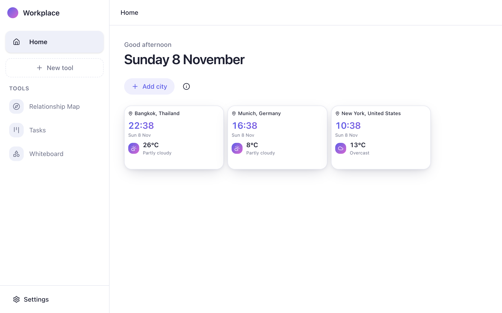
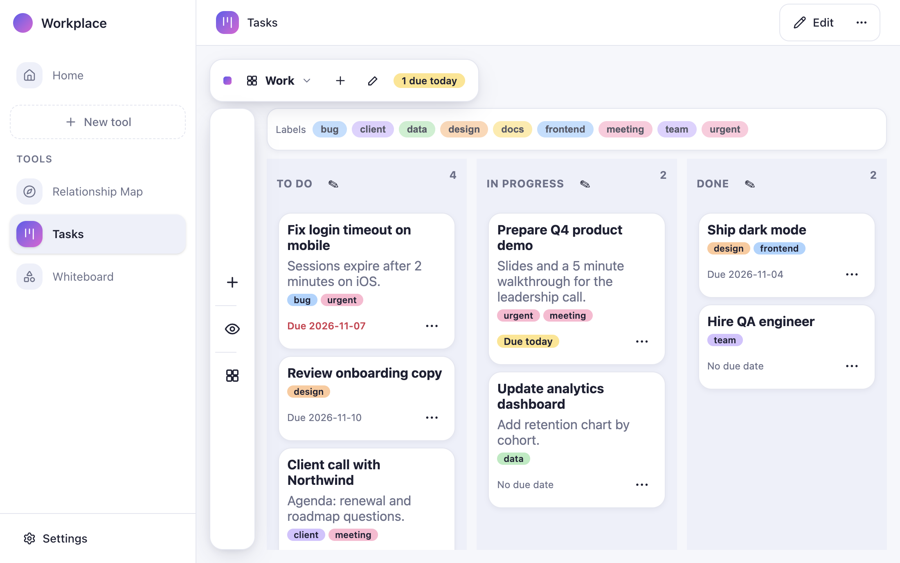
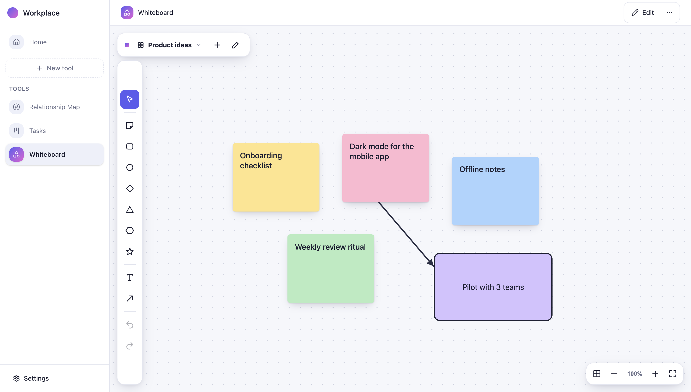
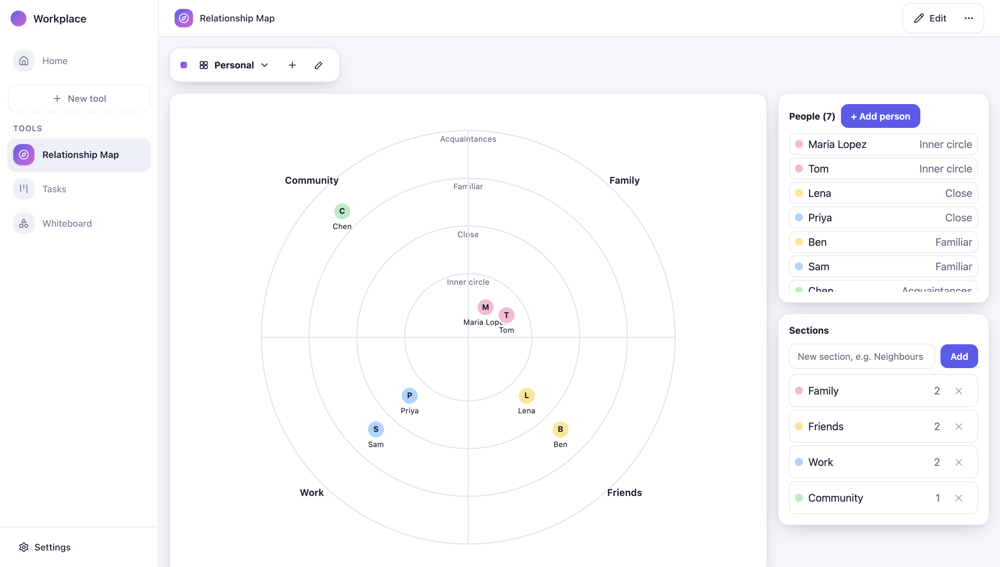

# Loft tools

Tools for the Loft app. Each folder is one tool package: `manifest.json`, `schema.json`, `ui/` and optional `ui/card.js`.

| Folder | Tool |
| --- | --- |
| `tasks/` | Tasks: boards, labels, columns and due dates |
| `whiteboard/` | Whiteboard: sticky notes, shapes, arrows and boards |
| `relationship-map/` | Relationship Map: people in circles, sections and boards |

## Screenshots

### Home

The home screen shows the date, the time and weather for your chosen cities, and the Add city button.

### Tasks

A board with three columns (To do, In progress, Done). Tasks carry labels and due dates, and tasks due today are highlighted in the title bar. The Work board is one of several boards, switched from the title bar.

### Whiteboard

An infinite canvas with sticky notes, shapes, text and arrows. Each board is a separate canvas, and a board's overview shows all of them.

### Relationship Map

People are placed in four circles of closeness and grouped into sections such as Family, Friends and Work. Dragging a person moves them to another circle or section.
